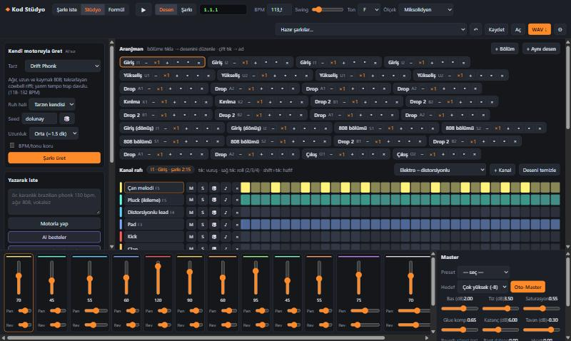

# Kod Stüdyo

**A music studio that makes music with code.** A rule-based composer writes complete songs in 20+ styles with no AI and no API keys. You can edit everything in a step sequencer and mixer. AI agents can drive the same engine over MCP.



- Desktop app for **Windows** and **macOS**, plus a **browser mode** for any OS with Node.js.
- **No API keys needed.** Every sound is synthesized with Web Audio or played from bundled CC0 instrument recordings. Claude and ElevenLabs are optional extras.
- **Agent-ready:** an MCP server, a CLI and an HTTP API let AI agents generate songs, edit their JSON, render WAV files and open them in your studio window.

> The app's interface is currently in Turkish. Agent tools, the CLI and the API accept English and Turkish prompts.

---

## For AI agents: install and connect

If a user gave you this repository link and asked you to install Kod Stüdyo, do the following.

**1. Run the installer for the user's OS.** It downloads the latest release, installs the app for the current user (no admin rights), and registers the `kod-studyo` MCP server with Claude Code if the `claude` CLI is available.

Windows (PowerShell):

```powershell
irm https://raw.githubusercontent.com/WebitroHQ/kod-studyo/main/scripts/install.ps1 | iex
```

macOS:

```bash
curl -fsSL https://raw.githubusercontent.com/WebitroHQ/kod-studyo/main/scripts/install.sh | bash
```

Linux (installs from source; needs git, Node.js 20+, and Chrome, Edge or Chromium for rendering):

```bash
curl -fsSL https://raw.githubusercontent.com/WebitroHQ/kod-studyo/main/scripts/install.sh | bash
```

If the repository is private and the raw URLs return 404, the user's GitHub account must have access. Sign in with `gh auth login`, then run the same script from a clone:

```bash
gh repo clone WebitroHQ/kod-studyo && cd kod-studyo
bash scripts/install.sh               # macOS / Linux
powershell -File scripts/install.ps1  # Windows
```

The scripts use `gh` for downloads when it is signed in.

**2. Connect the MCP server**, if the installer didn't do it automatically (it prints the exact command and arguments).

Windows:

```bash
claude mcp add kod-studyo -s user -e ELECTRON_RUN_AS_NODE=1 -- "%LOCALAPPDATA%\Programs\kod-studyo\kod-studyo.exe" "%LOCALAPPDATA%\Programs\kod-studyo\resources\app\bin\kod-studyo.mjs" mcp
```

macOS:

```bash
claude mcp add kod-studyo -s user -e ELECTRON_RUN_AS_NODE=1 -- /Applications/kod-studyo.app/Contents/MacOS/kod-studyo /Applications/kod-studyo.app/Contents/Resources/app/bin/kod-studyo.mjs mcp
```

From source, on any OS:

```bash
claude mcp add kod-studyo -s user -- node /path/to/kod-studyo/bin/kod-studyo.mjs mcp
```

For Claude Desktop, Cursor and other MCP clients, use the same command, args and env in their `mcpServers` config (see [AGENTS.md](AGENTS.md)). Restart the agent session so the new tools load.

**3. Verify.** Call the `studio_status` tool. Then call `generate_song` with `{"prompt": "calm lofi with piano", "length": 1}`. It returns the path of a rendered WAV file.

The app does not need to be running: the first tool call starts it in the background (tray icon, no window). Full tool reference: [AGENTS.md](AGENTS.md).

---

## Install (people)

Download from [Releases](https://github.com/WebitroHQ/kod-studyo/releases):

| OS | File |
|---|---|
| Windows 10/11 | `KodStudyo-<version>-Setup.exe` |
| macOS, Apple Silicon | `KodStudyo-<version>-arm64.dmg` |
| macOS, Intel | `KodStudyo-<version>-x64.dmg` |

The builds are not code-signed by a paid certificate:

- **Windows** may say *"Windows protected your PC"*. Click **More info → Run anyway**.
- **macOS** may say the app *"can't be opened"*. Right-click the app → **Open**, or run `xattr -cr /Applications/kod-studyo.app`. The install script does this for you.

Songs and WAV files are saved to `Documents/Kod Studyo/exports/`. Optional API keys go in the settings dialog (⚙) or in `Documents/Kod Studyo/.env`.

## Run from source

```bash
git clone https://github.com/WebitroHQ/kod-studyo.git
cd kod-studyo
npm install
npm run app      # desktop app (Electron)
npm start        # server only: open http://localhost:4209 in a browser
```

## Features

- **Rule-based composer (no AI):**
  - 20+ style profiles: Brazilian / drift / Memphis phonk, trap, drill, boom bap, lo-fi, house, techno, drum & bass, synthwave, hyperpop, ambient, reggaeton, afrobeats, pop, rock, acoustic, Turkish arabesk and more.
  - Seeded, so the same seed gives the same song.
  - Re-roll any single track.
- **Write it in words:** for example *"dark brazilian phonk 130 bpm, heavy 808, no vocals"*. Style, tempo, key, mood and instruments are detected from the text.
- **Studio:**
  - Arrangement of sections, patterns and repeats.
  - Step sequencer with rolls and ratchets.
  - Scale-locked piano roll with glide.
  - 25+ instruments: guitars, bass, bağlama, strings, brass, flute, 808, FM bells…
  - Mixer with pan, reverb, delay and sidechain ducking.
  - Master chain: EQ, saturation, glue compressor, limiter, tape wow.
  - Loudness-targeted **auto-master**.
- **Real instruments:** CC0 multisample kits are bundled:
  - Upright piano, violins, cellos, harp and flute from [VSCO 2 CE](https://github.com/sgossner/VSCO-2-CE).
  - A Gretsch electric guitar from [Karoryfer](https://github.com/sfzinstruments/karoryfer.black-and-green-guitars).
- **Formula songs:** music written entirely as math. Every voice is an expression evaluated per sample. Presets use primes, π, φ, the Collatz sequence and Eno-style phasing loops.
- **Optional AI:**
  - Claude composes and edits songs as structured JSON.
  - ElevenLabs adds vocals, sound effects and full songs.
  - Both need your own API keys; everything else works without them.
- **Export:** WAV, project JSON, undo.

## Project layout

| Path | What it is |
|---|---|
| `public/` | The studio UI and audio engine (Web Audio): `engine.js`, `instruments.js`, `generator.js`, `genres.js`, `formula.js` |
| `server.mjs` | Local server: static files, optional AI proxy, agent API |
| `lib/agent.mjs` | Agent HTTP API and render queue |
| `lib/mcp.mjs` | MCP server (stdio) |
| `bin/kod-studyo.mjs` | CLI |
| `public/worker.html` | Render worker. Agent renders run here, in a hidden app window or a headless Chrome/Edge. |
| `electron/` | Desktop app shell |
| `scripts/` | Install scripts |
| `compositions/` | Hand-written example songs (`node compositions/<name>.mjs`) |
| `tools/` | Audio analysis helpers (Python) |

## Building installers

```bash
npm run dist:win   # on Windows → dist/KodStudyo-<version>-Setup.exe
npm run dist:mac   # on macOS   → dist/KodStudyo-<version>-<arch>.dmg / .zip
```

The `build` workflow (`.github/workflows/build.yml`) builds both on GitHub Actions. Pushing a `v*` tag publishes a release, which is where the install scripts download from.

## Credits

- **Instrument recordings:** VSCO 2 Community Edition (CC0). The upright piano was recorded by Simon Dalzell (Ivy Audio) / Versilian Studios. The guitar is from Karoryfer Black and Green Guitars (CC0).
- **Vocal chops:** the vocal chops in `public/kits/phonk` and `public/kits/ankara` were generated with ElevenLabs text-to-speech.
- **License:** MIT for the code. See [LICENSE](LICENSE) for the bundled assets; the ElevenLabs vocal chops are for non-commercial use.
- **Made by:** [Webitro](https://webitro.com). Turkish documentation: [README.tr.md](README.tr.md).
